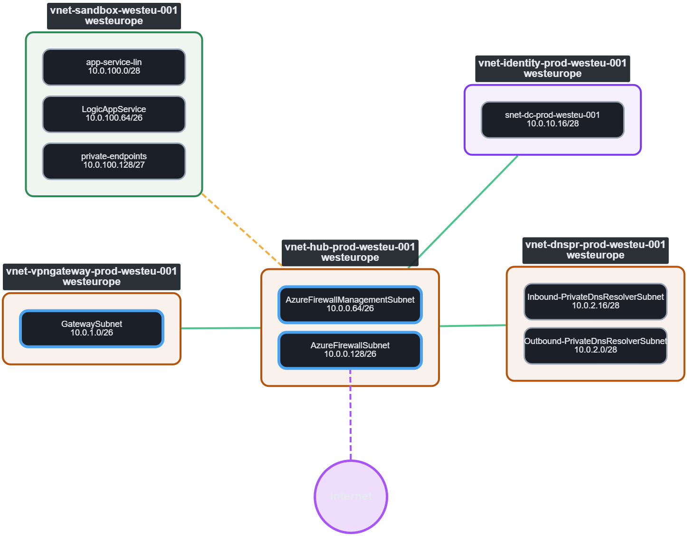

# Azure VNet Map

An interactive, single-file map of your Azure virtual networks. Export your VNets from **Azure Resource Graph**, open the file in the page, and get a clickable diagram of peerings, subnets, NSGs, route tables and Internet paths across **all your subscriptions**.

It is one HTML file. There is nothing to install, no server and no Azure sign-in. Your data is read in the browser and never leaves your machine.



## Features

- **VNet peering map** across multiple subscriptions. Peerings from both sides are merged into one line.
- **Peering health at a glance:** connected, not connected, one side only, and VNets outside your export (dashed).
- **Peering details on the lines:** gateway transit, remote gateways and forwarded traffic. Click a line for the full per-direction settings.
- **Nested boxes inside each VNet:** subnets, NSGs and route tables (UDR). Firewall, gateway, Bastion and route server subnets are highlighted.
- **Region and subscription at a glance:** every VNet shows its region, and you can colour the map by subscription or by region.
- **Internet node:** link VNets to the Internet by hand, or detect links from a second Resource Graph export (Azure Firewall, Bastion, Application Gateway, NAT gateway, NICs with a public IP, default routes to Internet).
- **Default routes through a firewall or appliance:** a 0.0.0.0/0 route to a virtual appliance is drawn as an arrow to the VNet that contains the next-hop IP.
- **Declutter:** hide subscriptions, regions or single VNets, hide VNets without peerings, search the lists.
- **Groups:** select several VNets and put them in a named, labelled box.
- **Arrange in grid:** from a button or the right-click menu, for VNets in a group, a selection, or the boxes inside a VNet. Columns and gap are remembered, and a grid can be kept after every re-layout.
- **Save and load layouts:** positions, groups, hidden items, toggles and grid settings go into a small JSON file you can reload next to a fresh export.
- **Export to PNG** for documentation, with optional light colours (even when your screen is in dark mode) and an optional transparent background.
- Light and dark mode follow your system setting.

## Quick start

1. Download `azure-vnet-peering-map.html`.
2. Get the data (see below) and download the result as CSV or JSON.
3. Open the HTML file in a modern browser and drop the export on the page, or use **Open file**.

An Internet connection is needed the first time the page loads, because it pulls its graph libraries from public CDNs (see [Privacy](#privacy)).

## Getting the data

You need read access (for example the **Reader** role) to the subscriptions you want to map.

1. Open [Azure Resource Graph Explorer](https://portal.azure.com/?feature.msaljs=true#servicemenu/Microsoft_Azure_Resources/ResourceManager/resourcegraphexplorer).
2. Paste the query below.
3. Set the **scope** to your whole directory so every subscription is included.
4. Click **Run query**, then **Download as CSV**.

The page also shows these queries under **Get the data** in the left menu, with copy buttons.

### Query 1: VNets (required)

```kusto
resources
| where type =~ 'microsoft.network/virtualnetworks'
| join kind=leftouter (
    resourcecontainers
    | where type =~ 'microsoft.resources/subscriptions'
    | project subscriptionId, subscriptionName = name
  ) on subscriptionId
| project id, name, subscriptionId, subscriptionName, resourceGroup, location, properties
```

Keep all columns. The `properties` column holds the subnets, address space and peerings.

### Query 2: Internet exposure (optional)

Open its export together with the VNet export to find Internet paths automatically.

```kusto
resources
| where type in~ (
    'microsoft.network/azurefirewalls',
    'microsoft.network/bastionhosts',
    'microsoft.network/applicationgateways',
    'microsoft.network/natgateways',
    'microsoft.network/networkinterfaces',
    'microsoft.network/routetables')
| where (type =~ 'microsoft.network/routetables' and tostring(properties.routes) contains '0.0.0.0/0')
    or (type !~ 'microsoft.network/routetables' and tostring(properties) contains 'publicIP')
| project id, name, type, properties
```

### Using the CLI instead

```bash
az extension add --name resource-graph
az graph query -q "<query>" --first 1000 -o json > vnets.json
```

### Row limits

Resource Graph returns at most 1000 rows per query (the CLI default is 100). For very large tenants, run the query per subscription or management group and load the results one at a time.

## Using the map

| Action | How |
| --- | --- |
| Open files | **Open file**, or drag and drop. You can select several files at once (VNet export, Internet export, saved layout). |
| Zoom and pan | Mouse wheel and drag on empty space. |
| Select several VNets | Shift-click, or Shift-drag on empty space. |
| Details | Click a VNet, subnet, NSG, route table, group or line. |
| Show subnets for one VNet | Click the VNet, then **Show subnets** in the details panel. |
| Show subnets, NSGs and UDRs for all | **Show on the map** in the left menu. |
| Group VNets | Select them, type a name, **Group selected**. |
| Arrange in grid | Click a group or select VNets and use **Arrange in grid**, or right-click a group or VNet. |
| Hide the left menu | **Hide menu** button in the top-left corner of the map. |
| Save your work | **Layout and export**, then **Save layout**. Load it again together with the data file. |

Files can be opened in any order: if you open the Internet export first, it waits until the VNet export is loaded.

### Right-click menu

Right-click a group, a VNet, or a box inside a VNet to arrange things in a grid. Each section remembers its **Columns** and **Gap**, and **Keep this grid after re-layout** re-applies it every time the layout runs. These settings are stored in the layout file.

### Layout file

**Save layout** writes a `<datafile>.layout.json` with node positions, zoom, groups, hidden subscriptions/regions/VNets, which VNets show their subnets, toggles, colour mode, manual Internet links and grid settings. Load it with a newer export of the same environment: items that are new are placed along the bottom, and items that no longer exist are ignored.

Groups are also remembered in the browser (local storage) per data file name.

## Supported input

- CSV or JSON from Resource Graph Explorer.
- JSON from `az graph query` (array, or the `{ "data": [...] }` wrapper).
- Output of `az network vnet list -o json` should also work for the VNet part (less tested than the Resource Graph export).
- CSV files where each whole line has been wrapped in quotes (a common side effect of re-saving in some editors) are unwrapped automatically.

## Privacy

- The file you open is parsed locally in your browser. Nothing is uploaded.
- The page loads its libraries from public CDNs: [Cytoscape.js](https://js.cytoscape.org/) from cdnjs, and the `fcose` layout with its two helper libraries from jsDelivr. If you need it fully offline, download those scripts and replace the `<script src>` tags with inline copies.
- Saved layout files contain resource names and IDs from your environment. Treat them like the export itself before sharing.

## Limitations

- Only **VNet peerings** are drawn between VNets. VPN, ExpressRoute and Virtual WAN connections are not mapped.
- Internet detection covers the resource types listed above. It does **not** detect public load balancers, or VMs that reach the Internet only through default outbound access.
- A 0.0.0.0/0 route to an appliance is linked to a VNet only if the next-hop IPv4 address lies inside the address space of a VNet in your export.
- The graph is a snapshot of the export, not a live view.
- Large environments with many subnets shown at once can get crowded. Use the filters, groups and per-VNet subnet view.
- Treat the result as documentation help and check important findings in the Azure portal.

## Troubleshooting

| Problem | What to try |
| --- | --- |
| "No virtual networks found" | Run Query 1 and keep all columns, including `properties`. |
| Nothing happens with the Internet file | Open it together with the VNet export, or after it. |
| `ParserFailure` in Resource Graph Explorer | Copy the query again from this page. Resource Graph supports only part of KQL, so keep each query as it is. |
| Many VNets show as dashed | Their peering partner is in a subscription that is not in your export. Widen the scope, or hide them under **Filter what is shown**. |
| Zoom feels too fast or slow | Change `ZOOM_STEP` near the bottom of the script (lower means smaller steps). |

## Requirements

A current desktop browser such as Edge, Chrome or Firefox. Touch devices have not been tested.

## Built with

[Cytoscape.js](https://js.cytoscape.org/) and [cytoscape-fcose](https://github.com/iVis-at-Bilkent/cytoscape.js-fcose).

## License

Add the license you want to use for this tool here, for example MIT.
